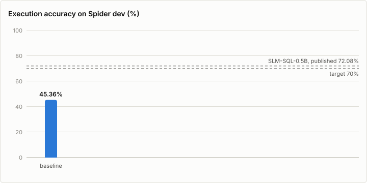

# Minnow-SQL-0.5B

[](https://github.com/thiscube/Minnow-SQL-0.5B/actions/workflows/checks.yml)
[](LICENSE)


Minnow-SQL-0.5B is a text-to-SQL model in the 0.5B-parameter class, fine-tuned from [Qwen2.5-Coder-0.5B-Instruct](https://huggingface.co/Qwen/Qwen2.5-Coder-0.5B-Instruct). Given a natural-language question and a database schema, it produces a SQL query.

> [!NOTE]
> The 70% goal is reached on Spider dev. Still to do: the final score on held-out test databases, and the weights release. See the [roadmap](#roadmap).

| | Spider dev EX |
| --- | ---: |
| Base model, untouched | 45.36% |
| Best single model (SFT, then reinforcement learning) | 66.92% |
| Vote of three fine-tuned adapters | **71.18%** |

## Goal

Reach at least 70% execution accuracy (EX) on the [Spider][spider] development set (1,034 questions), with a 0.5B-parameter model trained on one consumer GPU. A prediction counts as correct when its query runs and returns the same rows as the reference query.

## Results

Every run measured in this repository. The chart and table are generated from the runs' own files; [results.md](results.md) adds the kinds of error per run.

<!-- results:start -->



<details>
<summary>What each of the 16 runs changed</summary>

| Run | Change | Spider dev EX (%) | Correct |
| --- | --- | ---: | ---: |
| baseline | Baseline: no training, greedy decoding, CREATE TABLE statements as the schema | 45.36 | 469 / 1034 |
| sft-spider | LoRA fine-tuning on Spider train: 6,142 examples of at most 1,024 tokens, 3 epochs | 60.64 | 627 / 1034 |
| sft-spider-vote5 | Same model as sft-spider; five candidate queries per question, keeping the result most candidates agree on | 64.31 | 665 / 1034 |
| sft-spider-all | LoRA fine-tuning on Spider train plus train_others: 7,800 examples, 3 epochs, one greedy query | 59.77 | 618 / 1034 |
| sft-spider-all-vote5 | Same model as sft-spider-all; vote over five candidate queries | 65.09 | 673 / 1034 |
| sft-rows1 | LoRA fine-tuning with one example row per table in the schema: 5,259 examples, one greedy query | 61.51 | 636 / 1034 |
| sft-rows1-vote5 | Same model as sft-rows1; vote over five candidate queries | 65.76 | 680 / 1034 |
| vote-of-three | Vote across the three fine-tuned models' voted answers (15 candidate queries per question in total) | 68.67 | 710 / 1034 |
| sft-rows1-vote15 | Same model as sft-rows1, voting over 15 candidate queries instead of 5 | 67.02 | 693 / 1034 |
| sft-synsql | Fresh LoRA on Spider train plus a SynSQL-2.5M slice (12,215 examples that fit 1,024 tokens, 6,000 synthetic databases), 2 epochs, one greedy query | 61.80 | 639 / 1034 |
| sft-synsql-hints | Same model as sft-synsql; the prompt also lists question words found in the database's text values (value hints), one greedy query | 64.70 | 669 / 1034 |
| sft-rows1-hints | Same model as sft-rows1 (one example row per table); value hints added to the prompt, one greedy query | 62.28 | 644 / 1034 |
| vote-hints-three | Several models: vote across three fine-tuned adapters (sft-synsql with value hints, sft-rows1 with 15 candidates, sft-spider-all with 5), same majority rule as before | 71.18 | 736 / 1034 |
| grpo600-hints | RL pilot: GRPO from sft-synsql on 600 fresh SynSQL questions (only 252 fit 900 prompt tokens), lr 2e-5, value hints, one greedy query | 63.64 | 658 / 1034 |
| grpo-spider600-hints | RL pilot: GRPO from sft-synsql on 600 Spider train questions, lr 2e-5, value hints, one greedy query | 64.89 | 671 / 1034 |
| grpo-lr5-2400-hints | GRPO from sft-synsql on 2,400 Spider train questions, lr 5e-6, value hints, one greedy query (65.38% at 800, 65.76% at 1,600) | 66.92 | 692 / 1034 |

</details>

<!-- results:end -->

### How results are measured

- **Correct** means the query runs and returns the same rows as the reference query. Row order only matters when the reference query sorts.
- **One database per question.** A wrong query can pass when it and the reference both return nothing. results.md counts these.
- **Greedy or vote.** A run answers with one greedy query, or samples several, runs them and keeps the result most of them agree on. "Several models" means the candidates of more than one adapter are pooled.
- **Value hints.** The prompt also lists question words found in the database's text values. They come from plain text matching, never from the reference query.
- **Noise.** Differences of about one point are noise: redoing 200 questions with another batch size flipped 3 verdicts. All runs use batches of 16.
- **Dev is optimistic.** Settings such as the voting rule were chosen on dev. Spider test is therefore split by database: one half (1,230 questions) for choosing settings, the other (917 questions) scored once at the end.

### Published results for comparison

| Model | Training | Spider dev EX (%) | Spider test EX (%) | Source |
| --- | --- | ---: | ---: | --- |
| Qwen2.5-Coder-0.5B | none | 34.5 | | [model card][thesis] |
| Qwen2.5-Coder-0.5B | fine-tuned | 39.2 | | [model card][thesis] |
| Qwen2.5-Coder-0.5B-Instruct | none | 44.07 | 44.31 | [SLM-SQL][slm-sql] |
| SLM-SQL-0.5B | SFT and RL on SynSQL-derived data | 72.08 | 73.50 | [SLM-SQL][slm-sql] |

These rows were not reproduced here and are not directly comparable with this repository's numbers:

- SLM-SQL uses its own corrective self-consistency decoding.
- The model-card rows use the non-instruct base model.
- This repository scores with its own execution check on the original Spider databases, which is simpler than the official test-suite evaluation.

## Roadmap

- [x] Tooling: linting, tests, a train/dev leakage guard, continuous integration
- [x] Baseline: the unmodified base model, evaluated on Spider dev
- [x] Supervised fine-tuning on the Spider training set: 45.36% to 60.64%
- [x] Improvements: [SynSQL-2.5M][omnisql] data, value hints, voting, reinforcement learning
- [ ] Final evaluation: one score on the held-out half of Spider test
- [ ] Release: model weights on Hugging Face, a demo, and a write-up of the results

## Constraints

- Hardware: one NVIDIA RTX 3060 Ti (8 GB VRAM) and 32 GB of RAM.
- Cloud compute: at most $15 in total.
- Spider dev is used for evaluation only and never for training.

## Repository layout

```
minnow/       library code; imports without a GPU or deep-learning dependencies
tests/        unit tests and structure tests
scripts/      training, evaluation, the dashboard and the local check runner
results/      predictions, verdicts and score summary of each logged run
dashboard/    the local results page
results.md    the log of measured runs, generated from results/
FINDINGS.md   what each experiment showed and the decisions it led to
```

## Training and evaluation

Everything runs on one 8 GB GPU. A stopped run continues where it left off when started again with the same command.

### Setup

1. Install [PyTorch](https://pytorch.org/get-started/locally/) with CUDA support, then the model dependencies:

   ```bash
   pip install -e ".[model]"
   ```

2. Download [Spider][spider] and unpack it so that `data/spider/dev.json` and `data/spider/database/` exist.

3. Optional: download [SynSQL-2.5M][omnisql] to `data/synsql` and add a slice of it to the Spider folder. Column comments are removed so the schemas look like Spider's.

   ```bash
   python -m minnow.synsql data/synsql data/spider --databases 6000 --per-database 2
   ```

### Evaluate

```bash
python scripts/baseline.py                                    # the untouched base model
python scripts/baseline.py --adapter outputs/sft/adapter      # a trained adapter
```

| Option | What it does |
| --- | --- |
| `--value-hints` | adds value hints to the prompt |
| `--samples 15` | samples 15 candidate queries per question and votes |
| `--sample-rows 1` | shows one example row per table |
| `--split test_val.json` | scores another question file in the Spider folder |

The untouched model takes about 5 minutes and 3 GB of GPU memory on an RTX 3060 Ti.

### Train

Supervised fine-tuning with LoRA:

```bash
python scripts/train_sft.py --train-files train_spider.json train_synsql.json --epochs 2 --out outputs/sft
```

Reinforcement learning on execution results, starting from a supervised adapter:

```bash
python scripts/train_grpo.py --adapter outputs/sft/adapter --out outputs/grpo --value-hints --learning-rate 5e-6
```

Each question gets 8 sampled queries. One that returns the right rows earns 1, one that only runs earns 0.1, and the model is pushed toward the better ones. Both scripts check the training data with the [leakage guard](#data-leakage-guard) before they start.

### Vote across runs

```bash
python -m minnow.combine outputs/vote outputs/run-a outputs/run-b outputs/run-c --spider data/spider
```

Pools every saved candidate of the given runs and keeps the result most of them agree on.

### Split Spider test

```bash
python -m minnow.splits data/spider
```

Writes `test_val.json` (for choosing settings) and `test_final.json` (scored once at the end).

## Results log

No score in this repository is typed by hand. Three small tools turn a run's files into everything that is reported:

```bash
python -m minnow.outcomes outputs/run --spider data/spider    # judge a run again and count its errors
python -m minnow.compare results/baseline outputs/run         # which questions a change fixed or broke
python -m minnow.runlog add outputs/run --change "..."        # log the run and regenerate the reports
```

`runlog add` regenerates `results.md`, the chart and the results table in this README. `python -m minnow.runlog check` fails when any of them is out of date, and it is part of the checks below.

## Dashboard

A local page shows every logged run: scores, kinds of error, accuracy per database, and each question with the model's query next to the reference query.

```bash
python scripts/dashboard.py
```

It serves the repository on `127.0.0.1` only and reads the files under `results/` directly. Question text and reference queries appear when Spider is unpacked in `data/spider`.

## Development

Requires Python 3.12 or later.

```bash
python -m venv .venv
source .venv/bin/activate    # Windows: .venv\Scripts\activate
pip install -e ".[dev]"
```

Run the checks:

```bash
ruff format --check .
ruff check .
pytest
python -m minnow.runlog check
```

On Windows, `powershell -File scripts/verify.ps1` runs all of them in one step. The same checks run in CI on every push to `main`. They cover:

- formatting and linting with [ruff](https://docs.astral.sh/ruff/), including limits on function length and complexity
- unit tests with a 90% coverage floor on `minnow/`
- structure tests: every module has a test file, source files stay under a size limit, and any file that starts training must call the leakage guard
- the results log: every reported number matches the runs' files

### Data leakage guard

`minnow.guard` verifies that a training set shares no question and no database with the Spider dev set. Questions are compared after normalizing case, punctuation, and whitespace.

```bash
python -m minnow.guard train.json dev.json
```

Both files are JSON lists of objects with `question` and `db_id` fields, the format Spider uses. The command exits with 0 when the data is clean and with 3 when it finds a leak.

## License

The code in this repository is released under the [MIT License](LICENSE). The base model and the datasets are distributed under their own licenses.

## References

- Yu et al. [Spider: A Large-Scale Human-Labeled Dataset for Complex and Cross-Domain Semantic Parsing and Text-to-SQL Task][spider-paper]. EMNLP 2018.
- Hui et al. [Qwen2.5-Coder Technical Report][qwen-paper]. 2024.
- Li et al. [OmniSQL: Synthesizing High-quality Text-to-SQL Data at Scale][omnisql]. 2025. Source of SynSQL-2.5M.
- Sheng and Xu. [SLM-SQL: An Exploration of Small Language Models for Text-to-SQL][slm-sql]. 2025.

[spider]: https://yale-lily.github.io/spider
[spider-paper]: https://arxiv.org/abs/1809.08887
[qwen-paper]: https://arxiv.org/abs/2409.12186
[omnisql]: https://arxiv.org/abs/2503.02240
[slm-sql]: https://arxiv.org/abs/2507.22478
[thesis]: https://huggingface.co/alialialialaiali/qwen2.5-coder-spider-sql
